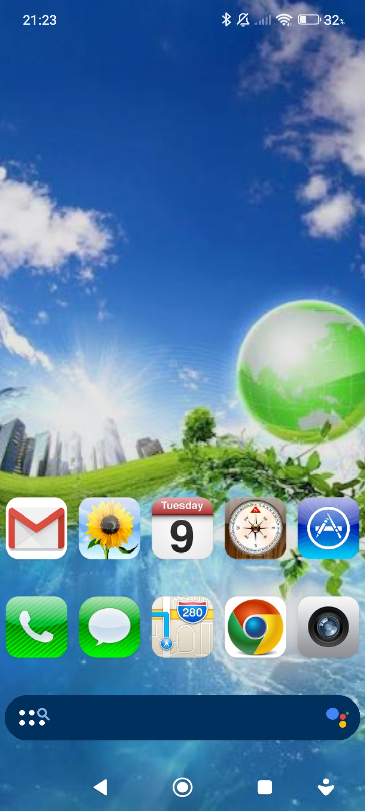

<div align="center">

# 🌐 Frutiger Aero Droid 💧


**Bring back the glossy, vibrant, and skeuomorphic aesthetic of the 2000s (Windows 7 / iOS 6 / early Android) to your modern Android device!**

</div>

---

## 📸 Preview
<p align="center">
  
</p>

---

## 📂 Project Structure

```text
Frutiger-Aero-Droid/
├── wallpapers/
│   └── default_wallpaper.jpg    # Classic glossy Frutiger Aero wallpaper
├── icons/
│   └── aero_icons.zip           # Frutiger Aero custom icon pack
├── launchers/
│   └── nova_launcher.apk        # Nova Launcher v6.0 Beta 12 (Android 5.0+)
├── backups/
│   └── backup.novabackup          # 1-click desktop layout backup (2 MB)
├── preview/
│   └── screenshot.png           # Home screen preview image
├── windows.sh                   # Setup script for Windows (USB & Wi-Fi ADB)
├── linux.sh                     # Setup script for Linux (USB & Wi-Fi ADB)
├── macos.sh                     # Setup script for macOS (USB & Wi-Fi ADB)
└── README.md
```

---

## 🚀 Quick Start & Installation

Download the repository as a **ZIP archive** (or clone it), extract it, and choose your preferred installation method:

### 💻 Method 1: Automatic Setup via PC (USB or Wi-Fi / Hotspot)
Enable **USB Debugging** (and *Install via USB* on Xiaomi/MIUI devices) in your phone's Developer Options.

Run the script for your OS:
* **Windows (Windows Terminal / Git Bash):** `bash windows.sh`
* **Linux:** `chmod +x linux.sh && ./linux.sh`
* **macOS:** `chmod +x macos.sh && ./macos.sh`

**Choose one of 3 connection modes in the terminal:**
1. **USB Cable:** Connect your phone via USB and allow debugging on the screen.
2. **Wi-Fi / Hotspot (Direct IP):** Connect your PC and phone to the same network or PC Mobile Hotspot, and enter your phone's IP address (defaults to port `5555`).
3. **Wi-Fi / Hotspot + First-Time Pairing (Android 11+):** Open *Developer Options -> Wireless Debugging -> Pair device with pairing code*, and enter the pairing `IP:Port` + 6-digit code directly in the script.

> 💡 **Restricted Wi-Fi Tip (School / Office Networks):** If client isolation blocks wireless ADB on public Wi-Fi, turn on **Mobile Hotspot** directly on your Windows 10/11 PC, connect your phone to it, and use your phone's local hotspot IP.

---

### 📱 Method 2: Manual Setup (Directly on Android)
If you don't have a PC nearby (or want to set it up right on your phone):

1. Extract the downloaded repository archive on your device.
2. Open the `launchers/` folder and install **`nova_launcher.apk`**.
3. Open the `wallpapers/` folder and set **`default_wallpaper.jpg`** as your home screen wallpaper.
4. Extract **`aero_icons.zip`** from the `icons/` folder.

---

## ⚡ Pro Tip: 1-Click Layout Restoration via `aero.novabackup`
Instead of placing icons manually, you can instantly restore an ideal Frutiger Aero desktop layout:
1. In Nova Launcher settings, go to **Backup & import** -> **Restore or import backup**.
2. Select the `aero.novabackup` file from the `backups/` folder.

---

## 🎨 How to Apply Custom iOS / Aero Icons in Nova Launcher

If you are setting up icons manually:
1. Press and hold any app icon on your home screen, then tap **Edit** (pencil icon).
2. Tap on the **icon image** itself.
3. Select **Gallery apps** and navigate to your extracted `icons/` folder.
4. Pick the matching glossy icon and save!

> *Tip: Go to Nova Settings -> Look & feel -> Icon style and enable **Normalize icon size** for a clean, uniform look.*

---

## ✨ Features
- **Lightweight & Compatible:** Uses **Nova Launcher**, ensuring smooth performance even on legacy and budget devices starting from **Android 5.0 (Lollipop)**.
- **All-in-One Local Kit:** Wallpapers, icons, and launcher APK are bundled locally—no external internet downloads required during setup.
- **Advanced ADB Support:** Deploy effortlessly over USB cable, local Wi-Fi, or a custom PC mobile hotspot with built-in Android 11+ pairing support.

---

## 📜 License
Open-source project created for custom Android styling and Frutiger Aero enthusiasts.
